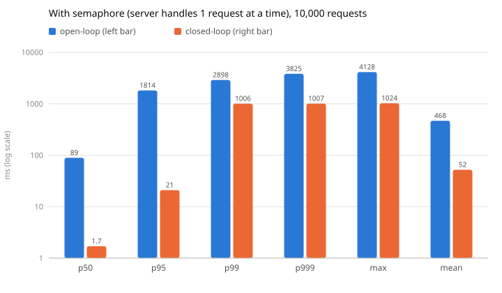
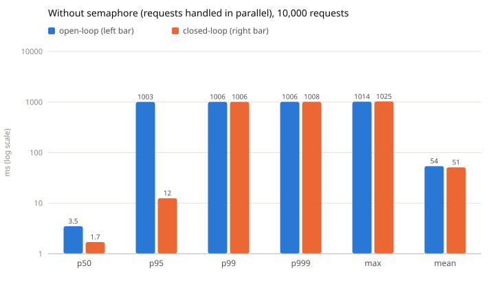

# Latency Lab: open-loop and closed-loop load generators

## Hypothesis

I expect that a closed-loop generator (it sends the next request only after the previous one finishes) will not reveal head-of-line blocking, while an open-loop generator (it sends requests on a schedule, without waiting for responses) will. When one slow request holds up processing, the requests that arrive behind it wait in a queue. A closed-loop generator never sends those requests, so it never measures their waiting time and underestimates the tail (the high percentiles). An open-loop generator sends them and measures them. I also expected to see this difference even without any limit on the server.

## Setup

- **Service:** an ASP.NET service (.NET 10.0.101, minimal API) with one endpoint that reads a product by `id` from PostgreSQL (version 18.7, running in Docker). The `Products` table (`Name`, `Price`) has 5000 rows, filled with a simple loop on the first start.
- **Slow requests:** 5% of requests wait for 1000 ms on purpose (chosen at random; both values are in the configuration).
- **Semaphore:** in one variant the server handles only **one request at a time** (`SemaphoreSlim(1, 1)`), so that a queue can form. In the other variant there is no semaphore.
- **Generator:** my own C# console program with one shared `HttpClient`. It measures from sending the request to receiving the response (`Stopwatch`).
  - Open-loop: one request every 100 ms (10 per second), without waiting for responses.
  - Closed-loop: one request after another, without a pause.
  - Warm-up: 40 requests before the tests; they are not part of the results.
  - Sample size: 10,000 requests per test.
- With the semaphore, the load on the server is about 50% (average processing time is about 53 ms, and a request arrives every 100 ms).

## Procedure

1. I started the server with PostgreSQL, filled the table, and built the endpoint.
2. I wrote the open-loop generator, then the closed-loop one. I added a count of requests above a time threshold ("heavy requests").
3. First runs with 100 requests (unstable percentiles, a first look at the variability).
4. I added the semaphore (first with a mistake in the initial value, which blocked all requests, then fixed to `1, 1`).
5. Runs with 10,000 requests **with the semaphore**, then **without the semaphore**. The arrival schedule was the same in both cases.

## Observations

**With the semaphore, 10,000 requests:**

| | open-loop | closed-loop |
|---|---|---|
| p50 | 89 ms | 1.7 ms |
| p95 | 1814 ms | 21 ms |
| p99 | 2898 ms | 1006 ms |
| p999 | 3825 ms | 1007 ms |
| max | 4128 ms | 1024 ms |
| mean | 468 ms | 52 ms |
| heavy requests | 3710 (37%) | 500 (5%) |

**Without the semaphore, 10,000 requests:**

| | open-loop | closed-loop |
|---|---|---|
| p50 | 3.5 ms | 1.7 ms |
| p95 | 1002.6 ms | 12.5 ms |
| p99 | 1005.9 ms | 1005.9 ms |
| p999 | 1006.5 ms | 1007.7 ms |
| max | 1013.7 ms | 1025.1 ms |
| mean | 53.9 ms | 50.9 ms |
| heavy requests | 504 | 490 |

**Smaller runs (100 requests, with the semaphore):** the open-loop mean was 296 / 1303 / 754 ms, and p50 ranged from 4 to 1220 ms. The closed-loop p99 was about 1005 ms every time.

**Percentile charts** (logarithmic axis, values from the tables above):

**Note on p95:** the difference in p95 on the chart without the semaphore (1002.6 ms for open-loop and 12.5 ms for closed-loop) is **random, not an effect of the generator type**. Exactly 5% of requests are slow, so p95 sits on the edge between fast and slow requests. By chance, the open-loop test had 504 slow requests (5.04%), so its p95 was slow, and the closed-loop test had 490 (4.90%), so its p95 was fast. In the next run it could be the other way round: in earlier runs of the same open-loop test, p95 was 7 ms, 11 ms, and sometimes about 1003 ms, with no change in the settings. For this reason, my conclusion about the difference between the generators is based on p99, p999, and max, not on p95.

## Conclusion

The hypothesis is partly correct. With the semaphore, the closed-loop test underestimates the tail: p99 is 1006 ms against 2898 ms (about 2.9 times), p999 is 1007 ms against 3825 ms (about 3.8 times), and the mean is 52 ms against 468 ms (about 9 times). The open-loop test shows that 37% of requests were slow, not 5%, because requests wait in the queue behind the slow ones. This is head-of-line blocking, and the closed-loop test does not see it, because it does not send new requests behind a slow one.

Reality differed from my expectation in one part: **without the semaphore there is no difference** (p99 is 1005.9 ms in both tests). The server handles requests at the same time, so a slow request does not hold back the ones behind it and no queue forms. A closed-loop test cannot hide a queue that does not exist. The difference appeared only when I limited the server to one request at a time.

The mean was a poor measure: the closed-loop mean of 52 ms does not describe any real user (most waited about 1.7 ms, and 5% waited more than a second). The p95 value is unstable when 5% of requests are slow: the edge was hit with 504 heavy requests (5.04%) against 490 (4.90%), which moved p95 from 12 ms to 1002 ms.

Limitations: one run per configuration; the arrival schedule is not perfectly fixed (`Task.Delay` adds a small drift); and the open-loop results with the semaphore depend strongly on how the slow requests happen to be spread in time (the load is close to saturation).

## One-sentence takeaway

A closed-loop test underestimates the tail because it does not send the requests that would wait behind a slow one, so only an open-loop test shows the true distribution of response times when the server has a queue.

---

# Latency Lab, part 2.B: tail latency amplification

## Hypothesis

If each of n parallel calls (to the same or to different backends) is slow in only 1% of cases, and a request waits for all of them (fan-out), the request is slow as soon as at least one call is slow. I expect the probability of a slow request to be **1 − 0.99ⁿ**: for n = 1, 10, 50, and 100 this is 1%, 9.56%, 39.50%, and 63.40%. (This is tail latency amplification.)

## Setup

- Each call is slow with probability 1%, **independently** of the others.
- A request fans out to n = 1, 10, 50, and 100 parallel calls and waits for all of them.
- Simulation: the Python script [`fanout_simulation.py`](mini-project/fanout_simulation.py), 10,000 requests for each n (a random number below 0.01 means the call is slow; a request is slow if at least one call is slow; random seed 42).
- The same experiment can be built in Google Sheets: the formula `=IF(SUMPRODUCT(--(RANDARRAY(B$1)<0.01))>0,1,0)` copied into 10,000 rows, then `=AVERAGE(...)` of the column. (In a sheet with Croatian settings, use `;` between arguments and `0,01`.)

## Procedure

1. I derived the formula. The probability that one call is fast is 0.99, so the probability that **all** n calls are fast is 0.99ⁿ. The request is slow when not all calls are fast, so the probability is **1 − 0.99ⁿ**. (The expression 0.01ⁿ is not this: it is the probability that all calls are slow at the same time.)
2. I calculated the probability for n = 1, 10, 50, and 100.
3. I simulated 10,000 requests for each n and compared the share of slow requests with the formula.

## Observations

| n | formula 1 − 0.99ⁿ | simulation (10,000 requests) | difference |
|---|---|---|---|
| 1 | 1.00% | 1.04% | +0.04 |
| 10 | 9.56% | 9.55% | −0.01 |
| 50 | 39.50% | 39.35% | −0.15 |
| 100 | 63.40% | 63.24% | −0.16 |

## Conclusion

The formula and the simulation agree in all cases. The differences are smaller than 0.2 percentage points, which is within the expected random noise for 10,000 trials (the standard error is about 0.5 percentage points). So the theory is correct: a slowness that is rare for one call becomes common when a request waits for many calls.

Limitation: the calculation assumes that the calls are **independent**. If the slowness is correlated (one cause hits several calls at once, for example the same overloaded machine), the share of slow requests would be different.

## One-sentence takeaway

A call that is slow in only 1% of cases makes about 40% of requests slow when a request waits for 50 calls, and about 63% (almost two out of three) when it waits for 100.

---

# Latency Lab, part 2.C: SLOs and error budget

## Hypothesis

I expect that the lab service meets the SLO for the typical user (p50) and the SLO for availability, but **breaks the SLO for the tail (p99)**, because 5% of requests are slow on purpose, by 1000 ms. I expect the error budget for p99 to be used up several times over.

## Setup

- **Measurement:** the SLOs are checked on the same experiment as in part 2.A: the open-loop generator, 10,000 requests, the service **without the semaphore**. The measurement is made on localhost, **without a network** (decision A: the SLO applies to the service, without network delay).
- **Assumed traffic** for the budget calculation: 10 requests per second, 30 days, so 10 × 86,400 × 30 = **25,920,000 requests** per month.
- **Measurement window** for all three SLOs: 30 days.

| SLO | target | good request | monthly error budget |
|---|---|---|---|
| 1: p50 < 10 ms | at least 50% of requests faster than 10 ms | response in less than 10 ms | 12,960,000 slower requests |
| 2: p99 < 800 ms | at least 99% of requests faster than 800 ms | response in less than 800 ms | 259,200 slower requests |
| 3: availability | at least 99% of requests succeed | status 2xx or 404 | 259,200 failed requests |

For availability, **a 404 is not a service error** (a missing id is a correct answer). A failure is any other status (in practice 5xx), an exception, or a timeout.

For availability, the budget can also be written as time: 1% of 30 days is 7.2 hours, which is **7 hours and 12 minutes**.

## Procedure

1. For each SLO, I set a target, a definition of a good request, and a window.
2. I calculated the monthly error budget from the assumed traffic: 1% of 25,920,000 is 259,200, and 50% is 12,960,000.
3. I added a counter of failed requests to the generator (exceptions, timeouts, and statuses of 300 and above except 404). It is reset to zero before each test.
4. I ran an open-loop test with 10,000 requests on the service without the semaphore and checked the SLOs against the measured values.

I deliberately did **not** use p95 in an SLO. Exactly 5% of requests are slow, so p95 sits on the edge and jumps between fast and slow from one run to the next.

## Observations

Measured (open-loop, 10,000 requests, without the semaphore):

| measure | value |
|---|---|
| p50 | 3.3 ms |
| p99 | 1005.2 ms |
| heavy requests (above 500 ms) | 521 (5.2%) |
| failed requests | 0 |

SLO check and budget use (monthly projection: about 5% of 25,920,000 = 1,296,000 slow requests):

| SLO | result | verdict | budget used |
|---|---|---|---|
| 1: p50 < 10 ms | p50 = 3.3 ms | met | ~10% (1,296,000 of 12,960,000) |
| 2: p99 < 800 ms | p99 = 1005.2 ms | **broken** | ~500% (1,296,000 of 259,200) |
| 3: availability 99% | 0 failed out of 10,000 (100%) | met | 0% |

For SLO 2, the service uses the budget five times faster than allowed, so the monthly budget would be gone in about **6 days** (30 days ÷ 5).

## Conclusion

The expectation was confirmed: SLO 1 and SLO 3 are met, and SLO 2 is broken. All three SLOs can be checked mechanically from the measurements: I count the good requests (faster than the threshold, or status 2xx or 404), divide by the total, and compare with the target. This also shows the lesson: p50 is green even when 5% of users wait a second, and only an SLO on the tail (p99) reveals the problem. I chose the 800 ms threshold clearly below the intended 1000 ms delay, so that the result does not depend on a few milliseconds.

Limitations:
- Measured on localhost **without a network**; in production, network delay would be added.
- Availability was checked only for an existing id, so a **404 never happened**, and the counter never saw a 5xx in practice.
- One run; the monthly budget is a projection from assumed traffic, not a measurement of a whole month.
- The share of requests slower than 10 ms (SLO 1) was not counted separately; it was estimated from the heavy requests.

## One-sentence takeaway

The service meets the SLO for the typical user and for availability, but breaks the SLO for the tail: 5% of slow requests use the p99 error budget five times faster than allowed, so the monthly budget would be gone in about 6 days.
